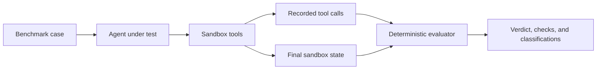

# BoliBench

**An open-source behavioural benchmark for tool-using conversational AI agents.**

BoliBench evaluates what an agent actually did—not what it said it did. It places an agent in a sandboxed order-management environment, records every tool call, and deterministically judges the final state and actions against each case's expected behaviour.

> A fluent reply is not evidence that a task succeeded. BoliBench judges the recorded actions and the resulting state, never the wording of the agent's reply.

**Live demo:** https://bolibench-demo-1b3o.onrender.com

**Repository:** https://github.com/CodewithJha/bolibench
**License:** Apache-2.0

---

## Table of contents

- [Why BoliBench exists](#why-bolibench-exists)
- [What it evaluates](#what-it-evaluates)
- [How it works](#how-it-works)
- [Quick start](#quick-start)
- [Running an evaluation](#running-an-evaluation)
- [Cases and review status](#cases-and-review-status)
- [Evaluation rules](#evaluation-rules)
- [Project structure](#project-structure)
- [Integrations and verification status](#integrations-and-verification-status)
- [Security and limitations](#security-and-limitations)
- [Documentation](#documentation)

## Why BoliBench exists

Consider the request:

> **कुर्ती वाले order की quantity 2 कर दो।**
> “Make the quantity of the kurti order 2.”

An agent might reply, fluently, that the kurti order was updated—while actually changing the kurta order. A reviewer reading only the transcript could mark that conversation as successful. The customer, however, receives the wrong items.

BoliBench was built to catch exactly this class of failure. It is designed for teams developing Hindi, Hinglish, Awadhi-influenced, and other real-world conversational support agents whose mistakes appear in tool calls and state changes rather than in grammar.

Potential uses include:

- Regression-testing agent prompts, tools, and model choices.
- Comparing open-weight models under the same behavioural cases.
- Testing whether an agent asks before consequential actions.
- Checking recovery after tool failures.
- Building private, domain-specific evaluation suites for customer-support workflows.

## What it evaluates

The current suite, `suites/orders`, contains **12 hand-written cases** covering:

- Hindi-English code-switching.
- Awadhi-influenced Hindi.
- Ambiguous references such as “the previous order” or “the red one”.
- Similar items and sellers, including kurta/kurti and Mohan/Sohan.
- Mid-conversation corrections.
- Requests that require clarification before acting.
- A forbidden bulk-cancellation request.
- Injected tool failures and recovery.

Agents interact with a sandbox through five tools:

| Tool | Purpose |
|---|---|
| `list_orders` | List available orders. |
| `get_order` | Inspect one order. |
| `cancel_order` | Cancel an order. |
| `update_quantity` | Change an order quantity. |
| `ask_user` | Ask for confirmation or clarification. |

## How it works



For every case, BoliBench:

1. Creates a fresh sandbox with the case's initial state.
2. Sends the user turns to the agent.
3. Records every attempted tool call, including rejected and failed attempts.
4. Applies only successful calls to the sandbox state.
5. Compares the final state and recorded actions with the expected behaviour.
6. Writes a complete JSON artifact for inspection and reproducibility.

The agent never receives the case ID, expected result, or evaluator-only fields.

## Quick start

### Requirements

- Python 3.11 or newer.
- [`uv`](https://docs.astral.sh/uv/).

### Install and validate

```sh
git clone https://github.com/CodewithJha/bolibench.git
cd bolibench
uv sync
uv run bolibench validate suites/orders
```

Expected validation result:

```text
suites/orders: 12 cases ok
```

### Run the test suite

```sh
uv run pytest
```

## Running an evaluation

BoliBench supports three evaluation modes.

### 1. Scripted evaluation

Use a fixed script to test the evaluator and sandbox without calling a model:

```sh
uv run bolibench run suites/orders/ambiguous-previous-order.json \
  --scripts examples/scripts/ambiguous-previous-order.json \
  --output runs/
```

A script contains one list of steps per user turn. Each step is one of:

```json
{"tool": "list_orders", "args": {}}
{"text": "A reply from the agent."}
{"reason": "An adapter failure."}
```

The scripted adapter is a deterministic test harness, not an AI agent. Its results demonstrate the evaluation machinery; they are not model results.

### 2. External agent over the webhook adapter

Run an agent as a local process and evaluate the full suite:

```sh
uv run bolibench run suites/orders \
  --agent-url http://127.0.0.1:8000/turn \
  --timeout 180 \
  --output runs/
```

BoliBench posts each user turn to the agent and provides a temporary, turn-scoped tool URL. The agent calls sandbox tools through that URL, and BoliBench records each call.

An example Ollama-based agent is included:

```sh
ollama serve
python examples/ollama_agent.py --model qwen3:8b --port 8000
```

### 3. Public demo server

Start the web interface locally:

```sh
uv run bolibench serve
```

The demo provides:

- Bundled benchmark results and their complete artifacts.
- A case-and-run comparison matrix.
- Behaviour signatures derived from expected actions.
- A free scripted-evaluation bench using the real evaluator.
- Integration statuses with explicit verification levels.
- An optional token-gated live-evaluation mode when a deployment is configured for it.

Live mode may call a hosted model API. It is disabled unless the required server-side configuration and demo token are set. Do not treat scripted evaluation as a live model run.

## Results and artifacts

Each run writes one JSON artifact per case and a `summary.json` file. An artifact contains:

- The user and agent transcript.
- Every recorded tool call and its status.
- The final sandbox state.
- Each deterministic evaluation check.
- The final verdict.
- Failure classifications where a rule supports them.

Available verdicts are:

| Verdict | Meaning |
|---|---|
| `pass` | All required checks passed. |
| `fail` | At least one behavioural check failed. |
| `error` | The agent or adapter could not complete the case. |
| `inconclusive` | Required evidence was missing, so the case could not be judged fairly. |

BoliBench reports verdict counts. It does not convert them into a hidden score, ranking, or model-quality claim.

## Cases and review status

A suite is a directory of JSON files. Each case defines:

- User turns.
- Optional agent-visible context.
- Initial sandbox state.
- Expected final state.
- Required and forbidden actions.
- Ask-before-acting expectations.
- Optional injected tool failures.

Review status is intentionally explicit:

- **Schema validity** — the case loads and validates.
- **Behaviour review** — the expected behaviour has been internally reviewed.
- **Linguistic review** — a native speaker has reviewed the utterances.

At present, all 12 cases are `proposed` and have not received native-speaker review. This limitation is stated in the demo and should be considered when interpreting language-related findings.

Generate a review sheet for a Hindi/Awadhi reviewer with:

```sh
uv run bolibench review-sheet suites/orders > review.md
```

## Evaluation rules

BoliBench applies the following principles consistently:

- Required actions are satisfied only by successful calls.
- Forbidden actions fail on any matching attempt, including rejected attempts.
- Rejected and failed calls never change sandbox state.
- Ask-before-acting requires the question in an earlier turn than the consequential action.
- Missing tool-call evidence or final state produces `inconclusive`, never `pass`.
- With `exclusive_actions`, consequential calls that match no required action are treated as forbidden attempts.
- A recovered injected failure is not blamed as an unrecovered recovery failure.
- The agent's reply is stored for inspection but is never used as evidence of success.

Exit codes for `bolibench run`:

| Code | Meaning |
|---|---|
| `0` | Every evaluated case passed. |
| `1` | At least one case failed, errored, or was inconclusive. |
| `2` | Invalid input; nothing was run. |

## Project structure

```text
src/bolibench/
├── adapters.py       Agent contracts and the scripted adapter
├── cli.py            validate, review-sheet, run, export, and serve commands
├── evaluate.py       Deterministic checks and failure classification
├── models.py         Case, run, evaluation, and artifact models
├── runner.py         Case execution and artifact writing
├── sandbox.py        In-memory order sandbox and tool-call recording
├── server.py         Public demo and evaluation API
├── store.py          Case and suite loading
├── webhook.py        External-agent adapter and tool gateway
├── speech.py         Optional speech round-trip
├── export*.py        Optional database exports
└── temporal_run.py   Optional durable evaluation runs

suites/orders/        The 12-case benchmark suite
examples/scripts/     Passing scripted example for every case
examples/             Ollama, Mastra, and Backboard example agents
demo/runs/            Bundled run artifacts used by the demo
docs/                 Audits, integration guides, and deployment notes
tests/                Automated test suite
```

## Integrations and verification status

Optional integrations are not required for the core benchmark. The status below distinguishes deployed, hosted, local, partial, and offline verification; these labels must not be interchanged.

| Technology | Actual use | Verification status |
|---|---|---|
| Render | Hosts the public demo and its token-gated live-evaluation mode. | **Deployed and verified.** |
| Gemma | Evaluated locally with `gemma3:4b`; hosted evaluation with `gemma-4-31b-it` through the Gemini API. | **Verified locally and hosted.** |
| ElevenLabs | Optional speech round-trip: TTS generates audio and STT supplies the transcript given to the agent. | **Verified against the hosted API via CLI; three end-to-end cases.** |
| Mastra | TypeScript example agent evaluated through BoliBench's tool gateway. | **Verified locally; 6/12 in one full-suite run.** |
| Temporal | Runs a benchmark suite as a durable workflow with one activity per case. | **Verified locally, including worker termination and recovery.** |
| Backboard | Bridge for evaluating agents through Backboard's API. | **Real API round-trip verified; multi-model comparison blocked by free-tier billing.** |
| Sentry | Agent-tracing spans using the Sentry SDK. | **Tested offline with an in-memory transport; no DSN configured.** |
| MongoDB | Exports run history with idempotent upserts and indexes. | **Verified against local MongoDB; Atlas not used.** |
| TimescaleDB / pgvector | Exports run history and supports similar-failure search with embeddings. | **Verified locally; Tiger Cloud not used.** |
| DigitalOcean | OpenAI-compatible configuration and App Platform specification. | **Implemented but never called; no credentials were available.** |

Further detail is available in [`docs/sponsor-evidence-matrix.md`](docs/sponsor-evidence-matrix.md) and [`docs/live-verification-report.md`](docs/live-verification-report.md).

## Security and limitations

### Security notes

- The webhook adapter accepts only local `http` agent URLs.
- Tool access is scoped by a random token for the active turn.
- The public scripted evaluator never accepts an agent URL from the request.
- Live evaluation is token-gated, rate-limited, and subject to a daily cap when enabled.
- Secrets are supplied through server-side environment configuration and are not stored in benchmark artifacts.

These controls are development and demo safeguards, not a substitute for production security review.

### Known limitations

- The benchmark currently contains 12 synthetic order-management cases.
- No case has received native-speaker linguistic review.
- Bundled model runs are single, unseeded executions; small differences may reflect sampling variation.
- The default evaluation is transcript-based. The optional speech mode uses synthetic voices, not real customer recordings.
- Failure classification is a deterministic rule set and can be incomplete or wrong.
- Local integrations should not be described as hosted or production integrations.

## Documentation

- **Deployment:** [`docs/deployment.md`](docs/deployment.md)
- **Benchmark audit:** [`docs/benchmark-audit.md`](docs/benchmark-audit.md)
- **Integration index:** [`docs/integrations.md`](docs/integrations.md)
- **Evidence matrix:** [`docs/sponsor-evidence-matrix.md`](docs/sponsor-evidence-matrix.md)
- **Live verification:** [`docs/live-verification-report.md`](docs/live-verification-report.md)
- **Submission draft:** [`docs/dev-post-draft.md`](docs/dev-post-draft.md)

## License

BoliBench is released under the [Apache License 2.0](LICENSE).
